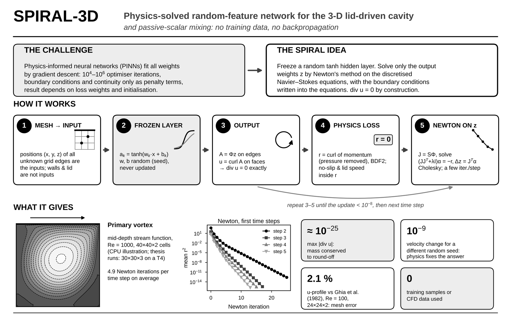
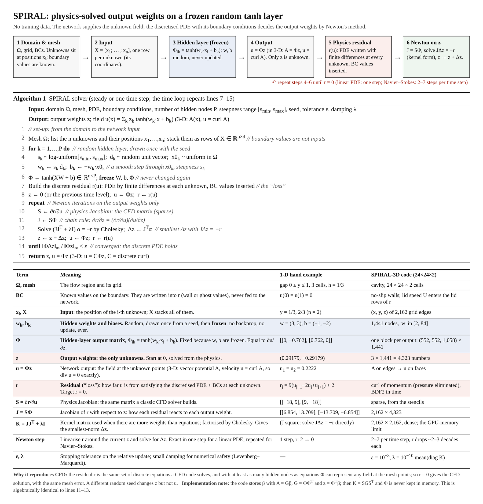
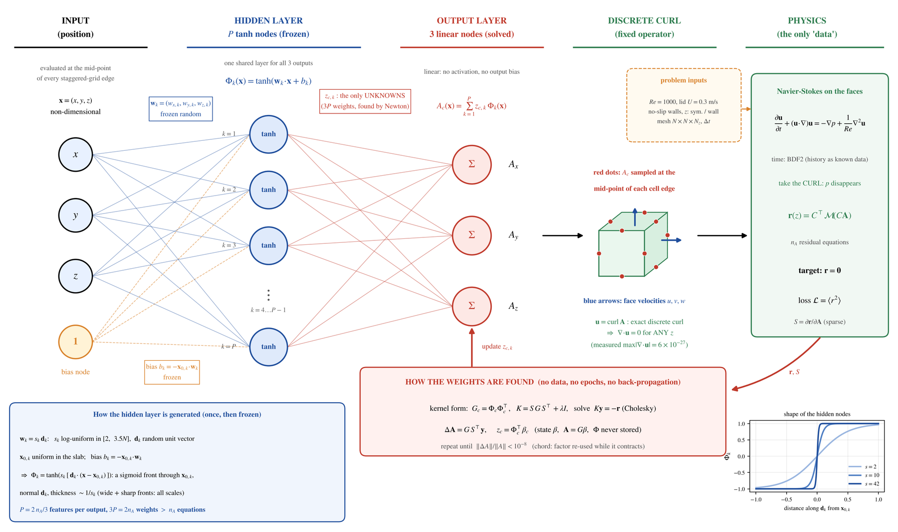
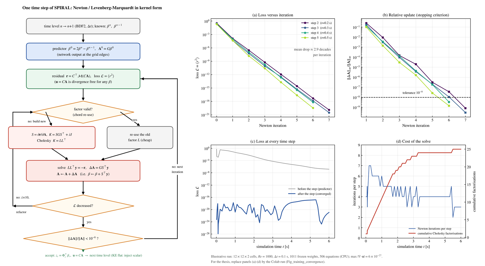
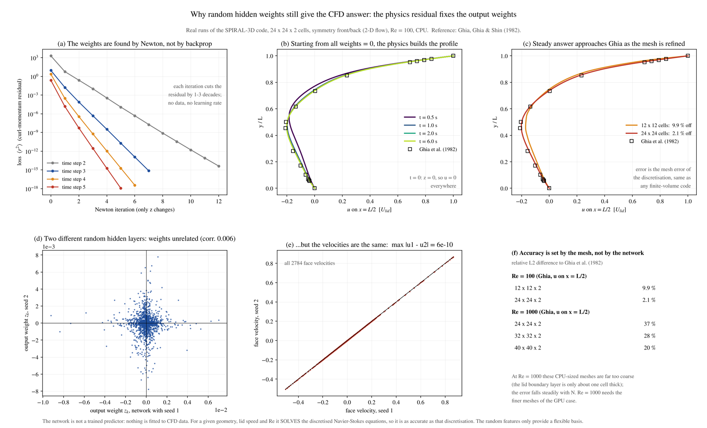
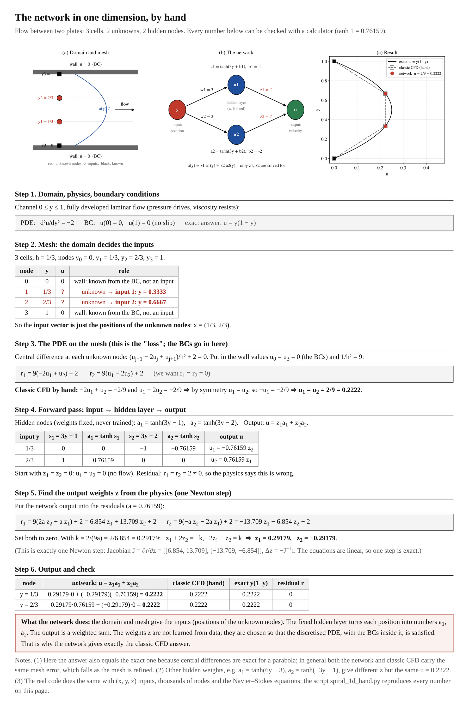

<div align="center">

# SPIRAL-3D

### A physics-solved neural network for 3-D incompressible flow — no training data, no backpropagation

**S**tream-function **P**hysics-**I**nformed **RA**ndom-feature **L**earning, applied to the 3-D lid-driven cavity and passive-scalar mixing




</div>

---

## In one paragraph

SPIRAL represents the flow with a one-hidden-layer neural network whose hidden weights are **random and frozen**. Only the output weights are unknown, and they are not *trained*: they are **solved** with Newton's method so that the discretised Navier–Stokes equations hold at every grid point. The velocity is the curl of the network output (a vector potential), so **mass is conserved to machine precision by construction**. The result is a neural-network solver that behaves like a classic CFD code — deterministic, convergent under mesh refinement, independent of the random seed — while keeping a continuous, differentiable network representation of the field.

## Highlights

| | |
|---|---|
| **No data** | Inputs are grid positions; the only "loss" is the discretised PDE with its boundary conditions. No CFD results, measurements or pre-training. |
| **Exact continuity** | u = ∇×A on a staggered grid → max \|∇·u\| ≈ 10⁻²⁵ for *any* weights. |
| **Newton instead of SGD** | Kernel-form Levenberg–Marquardt with Cholesky (chord re-use): the residual falls 2–3 orders of magnitude per iteration; ~5 Newton iterations per time step. |
| **Seed-independent** | Two different random hidden layers give output weights with correlation 0.006 but velocities equal to 10⁻⁹: the physics fixes the answer. |
| **Verified** | Matches a classic finite-difference solve of the same equations to round-off; 2.1 % from Ghia et al. (1982) at Re = 100 on a 24×24 mesh, error falling as 1/N². |
| **Full pipeline** | Transient 3-D flow (BDF2) → passive-scalar transport (second network, conservative FV, linear upwind) → mixing index, centre of gravity, kinetic energy, cost report. |

## Benchmarking in Lid Driven Cavity Against CFD Result


## How it works



1. **Mesh → inputs.** Every unknown value of the vector potential sits on a grid edge; its coordinates (x, y, z) are one input row. Boundary values are known and are *not* inputs.
2. **Frozen random layer.** `a_k(x) = tanh(w_k·x + b_k)`, with `w_k = s_k d_k` (log-uniform steepness, random direction) and `b_k = −w_k·x0_k`. Drawn once from a seed, never updated.
3. **Output.** `A = Φz` on the edges, `u = curl A` on the faces.
4. **Physics residual.** Curl of the momentum equations (pressure eliminated), BDF2 in time; no-slip walls and the lid speed enter here.
5. **Newton on z.** `J = SΦ`, solve `(JJᵀ + λI)α = −r`, `Δz = Jᵀα`; repeat until the relative update < 10⁻⁸.

| Network | Solver |
|---|---|
|  |  |

### Why a random network gives the CFD answer

The residual is the same set of discrete equations a CFD code solves. With at least as many hidden nodes as equations, the frozen layer can represent any field at the mesh points, so `r = 0` *is* the CFD solution — with the same mesh error, which falls as the mesh is refined. The random seed changes the weights, not the flow.



### See it by hand

A 1-D channel flow with 3 cells, 2 unknowns and 2 hidden nodes — every number can be checked with a calculator, and [`examples/spiral_1d_hand.py`](examples/spiral_1d_hand.py) reproduces them.



## Quick start

```bash
pip install -r requirements.txt
python examples/spiral_1d_hand.py          # the 1-D example, milliseconds
S3_QUICK=1 python ldc3d_spiral.py          # 12×12×2 pipeline check on a CPU
```

**Google Colab (recommended for the full case):** Runtime → *T4 GPU*, upload `ldc3d_spiral.py`, then

```python
%run ldc3d_spiral.py
```

### Configuration (environment variables)

| Variable | Default | Meaning |
|---|---|---|
| `S3_QUICK` | `0` | `1` = tiny mesh, pipeline check only |
| `S3_OUT` | `/content/ldc3d_results` | output folder |
| `S3_RE` | `nominal` | `nominal` → Re = 1000; `table` → Re from the property table |
| `S3_ZWALL` | `symmetry` | front/back faces: `symmetry` (2-D-equivalent) or `noslip` (truly 3-D) |
| `S3_CFG` | — | JSON overrides of `CFG`, e.g. `'{"N": 40, "Nz": 4}'` |
| `RCFD_DIR` | `/content/rcfd` | optional ANSYS Fluent reference CSV files for comparison |
| `S3_ANSYS_COST` | — | optional Fluent wall time/RAM for the cost table |

Main knobs in `CFG`: `N`, `Nz` (mesh), `ratio` (hidden nodes per equation, default 2), `dt`, `tol_psi` (Newton tolerance, 10⁻⁸), `seed`.

### Outputs

`Fig_centrelines` (vs Ghia et al. 1982), `Fig_vortices_midsection`, `Fig_flow_slices`, `Fig_3D_streamlines`, `Fig_3D_velocity_isometric`, `Fig_training_convergence`, `Fig_KE_MI_CoG`, `Fig_computational_cost`, `phi_mixing.gif`, plus `kinetic_energy.csv`, `mixing_index.csv`, `center_of_gravity.csv`, `flow_training_history.csv`, `computational_cost.txt`, `report.txt` and the final network weights `flow_network_final.pt`. Long runs checkpoint automatically and resume after a Colab disconnect.

## SPIRAL vs. a physics-informed neural network (PINN)

| | PINN | SPIRAL |
|---|---|---|
| Hidden weights | trained | random, frozen |
| Output weights | trained by gradient descent (10⁴–10⁶ iterations) | solved by Newton (a few iterations per time step) |
| Boundary conditions | penalty terms in the loss | written into the discrete equations |
| Continuity | penalty term, approximate | exact (curl of a vector potential) |
| Result vs random seed | varies | identical to 10⁻⁹ |
| Accuracy controlled by | network size, loss weights, optimiser | the mesh, like CFD |

SPIRAL belongs to the family of extreme-learning-machine / random-feature PDE solvers (e.g. PIELM, local ELM, the random feature method); its distinctive pieces are the vector-potential output with an exact discrete curl, the pressure-free curl-momentum residual, and the kernel-form Newton solve for 3-D transient Navier–Stokes.

## Limitations (honest)

- The kernel matrix `K = SGSᵀ` is **dense**: memory grows as n_eq² and the Cholesky factor as n_eq³. On a 15 GB T4, 30×30×3 runs in seconds per step, 40×40×4 needs a float32 factor, 50×50×5 (1 mm cells) is borderline. Production-size meshes need a sparse or domain-decomposed formulation.
- Accuracy is the accuracy of the second-order discretisation: at Re = 1000 the meshes above are still mesh-limited.
- Validated so far on the lid-driven cavity (Ghia et al. 1982, ANSYS Fluent reference) and scalar mixing in it.

## Repository

```
ldc3d_spiral.py            full 3-D solver: flow + scalar + figures + cost report
examples/spiral_1d_hand.py 1-D hand-calculation example
docs/                      figures used in this README
requirements.txt
```

## Citation

```bibtex
@mastersthesis{spiral3d,
  title  = {SPIRAL-3D: a physics-solved random-feature network for the 3-D lid-driven cavity and passive-scalar mixing},
  author = {<Your Name>},
  school = {Johannes Kepler University Linz},
  year   = {2026}
}
```

## References

- U. Ghia, K. N. Ghia, C. T. Shin, *High-Re solutions for incompressible flow using the Navier–Stokes equations and a multigrid method*, J. Comput. Phys. 48 (1982) 387–411.
- M. Raissi, P. Perdikaris, G. E. Karniadakis, *Physics-informed neural networks*, J. Comput. Phys. 378 (2019) 686–707.
- S. Dong, Z. Li, *Local extreme learning machines and domain decomposition for solving linear and nonlinear PDEs*, CMAME 387 (2021) 114129.

---

<div align="center"><sub>Built at Johannes Kepler University Linz · questions and issues welcome</sub></div>
